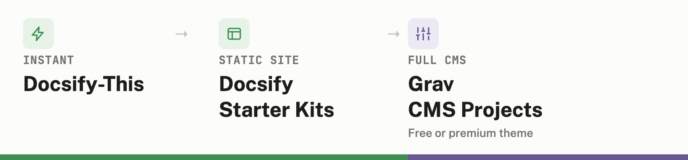

<picture>
  <source media="(prefers-color-scheme: dark)" srcset="https://raw.githubusercontent.com/hibbitts-design/.github/main/profile/hibbittsdesign-readme-banner-dark.png">
  <source media="(prefers-color-scheme: light)" srcset="https://raw.githubusercontent.com/hibbitts-design/.github/main/profile/hibbittsdesign-readme-banner.png">
  
</picture>

# Hello there, here are open-source tools for turning Markdown into websites for open education and&nbsp;publishing 👋🏼

All projects share a common foundation: open, portable, and constraint-free Markdown files. Start simple with the no-signup [Docsify-This](https://hibbittsdesign.org/docsify-this.html) web app, self-host and customize further with the [Docsify Starter Kits](https://hibbittsdesign.org/docsify-starter-kits.html), or go further still with a full, database-free CMS: free with [Grav Open Publishing Space](https://hibbittsdesign.org/grav-open-publishing-space.html) or [Grav Open Course Space](https://hibbittsdesign.org/grav-open-course-space.html), or with [Grav Helios Open Reader](https://hibbittsdesign.org/grav-helios-open-reader.html) or [Grav Helios Course Hub](https://hibbittsdesign.org/grav-helios-course-hub.html) on the Grav Premium Helios theme as a step up – see [Grav CMS Projects at a Glance](https://hibbittsdesign.org/grav-projects-at-a-glance.html). Easy to start with, easy to switch between, and easy to leave if your needs change. Not sure where to start? The [Read, Move, Reuse guide](https://read-move-reuse.hibbittsdesign.org/guide) is a short introduction.

## Recent Highlights

**`PUBLISH` `FREE` [Docsify-This v2.2](https://hibbittsdesign.org/docsify-this.html)** (built with Docsify v5.1)  
🔗 [Docsify-This.net](https://docsify-this.net) · 📦 [GitHub repository](https://github.com/hibbitts-design/docsify-this)  
*Turn any online Markdown file into a shareable, styled web page – instantly, with no signup and no build step. 🏆 Open Infrastructure Finalist, 2024 Open Education Awards for Excellence*

**`STATIC SITE` `FREE` `NEW` [Docsify Starter Kits](https://hibbittsdesign.org/docsify-starter-kits.html)**  
🔗 [Open Courses](https://hibbitts-design.github.io/docsify-open-courses-starter-kit/) · [Guide](https://hibbitts-design.github.io/demo-docsify-open-publishing-starter-kit-guide/) · [Multiple Guides](https://hibbitts-design.github.io/demo-docsify-open-publishing-starter-kit-multiple-guides/) · 📦 [Open Courses Kit repository](https://github.com/hibbitts-design/docsify-open-courses-starter-kit) · 📦 [Open Publishing Kit repository](https://github.com/hibbitts-design/docsify-open-publishing-starter-kit)  
*Your own site on GitHub Pages, with no build step – one course or many with a Courses page of cards, or open guides with their own covers and reading order*

**`FULL CMS` `FREE` [Grav Open Publishing Space](https://hibbittsdesign.org/grav-open-publishing-space.html)**  
🔗 [Demo](https://demo.hibbittsdesign.org/grav-open-publishing-quark2/) · 📦 [GitHub repository](https://github.com/hibbitts-design/grav-skeleton-open-publishing-space) · ⬇️ [Download](https://getgrav.org/downloads/skeletons#open-publishing-space-site)  
*An open guide or book site, with a blog and almost any other Grav page alongside it – Keep My Place, a Previous/Next bar on phones, diagrams and math, and the Markdown of any page, on Grav 2 or 1.7*

**`FULL CMS` `FREE` `NEW` [Grav Open Course Space](https://hibbittsdesign.org/grav-open-course-space.html)**  
🔗 [Demo](https://demo.hibbittsdesign.org/grav-open-course-space/) · 📦 [GitHub repository](https://github.com/hibbitts-design/grav-skeleton-open-course-space) · ⬇️ [Download](https://github.com/hibbitts-design/grav-skeleton-open-course-space/releases/latest)  
*One course or many on one site, each with its own menu, colour and header image – modules or weekly units, a blog for all courses or just one, and pages that embed in any LMS. The free successor to Grav Open Course Hub and Open MultiCourse Hub, on Grav 2 (an early preview)*

**`MIGRATE` `BETA` Free Conversion Tools**  
🔗 [Pressbooks Converter](https://grav-pressbooks-converter.hibbittsdesign.org/) · [Common Cartridge Converter](https://grav-common-cartridge-converter.hibbittsdesign.org/) · [Grav Docsify Bridge](https://grav-docsify-bridge.hibbittsdesign.org/) · [Grav Converters](https://grav-converters.hibbittsdesign.org/)  
*Convert a Pressbooks book, or a Canvas, Moodle, Brightspace, or Blackboard course, into the free Grav Open Publishing Space or Open Course Space (or Grav Premium Helios) – and move open guides and courses between Docsify and Grav, in either direction*

**`PLUGINS` `NEW` [Mermaid](https://hibbittsdesign.org/cost-free-grav-projects.html#mermaid-plugin) and [LaTeX Math](https://hibbittsdesign.org/cost-free-grav-projects.html#latex-math-plugin)**  
🔗 [Mermaid demo](https://demo.hibbittsdesign.org/grav-open-publishing-quark2/open-education-essentials/what-is-open-education/getting-started-with-oer#three-entry-points) · [LaTeX Math demo](https://demo.hibbittsdesign.org/grav-plugin-latex-math/) · 📦 [Mermaid repository](https://github.com/hibbitts-design/grav-plugin-mermaid) · 📦 [LaTeX Math repository](https://github.com/hibbitts-design/grav-plugin-latex-math) · ⬇️ [Mermaid download](https://getgrav.org/downloads/plugins#mermaid) · ⬇️ [LaTeX Math download](https://getgrav.org/downloads/plugins#latex-math)  
*Mermaid diagrams and LaTeX math (including chemistry) drawn from text in a page, matching the theme’s light or dark mode – easy to revise and remix, and read by screen readers, on Grav 2 or 1.7*

**[HibbittsDesign.org](https://hibbittsdesign.org/)** creates open-source software that turns Markdown into modern, self-managed websites for educators, digital publishers, and content creators, and supports the wider Markdown publishing community – built on over 25 years of experience in software interaction design, UX consulting, and higher education.

Built with a focus on outcomes over features, these projects strive to be both enjoyable and valuable.

See what [educators and users are saying](https://hibbittsdesign.org/testimonials.html) about these projects.

 Read more about <strong> HibbittsDesign.org </strong> projects, additional services, and more 

## What’s happening these days?
### 💻 Docsify Projects (docsify.js.org)
A documentation-style platform for Markdown publishing that requires no Web server or build process, making it accessible to a broader audience.

#### Docsify Web App
- [Docsify-This.net](https://docsify-this.net/) for content publishers, educators, creators and groups seeking a simple way to turn Markdown files into styled websites.
  - Docsify-This guide and course templates, ready to copy:
    - [Guide Site Template](https://github.com/hibbitts-design/docsify-this-guide-site)
    - [Multiple Guides Site Template](https://github.com/hibbitts-design/docsify-this-multiple-guides-site)
    - [Courses Site Template](https://github.com/hibbitts-design/docsify-this-courses-site)
  - Loadable configurations of popular LMS content styles for Docsify-This:
    - [Brightspace Config](http://load-brightspace.docsify-this.net)
    - [Canvas Config](http://load-canvas.docsify-this.net)
    - [Moodle Config](http://load-moodle.docsify-this.net)
    - [Sakai Config](http://load-sakai.docsify-this.net)
  - Loadable configurations for presentation content styles with Docsify-This:
    - [Basic Presentation](http://present.docsify-this.net)
    - [Presentation with Docsify Sidebar for Navigation](http://present-nav.docsify-this.net)

#### Docsify Starter Kits
- [Docsify Open Course Starter Kit](https://github.com/hibbitts-design/docsify-open-course-starter-kit) for course authors and facilitators. Best for users comfortable with GitHub/Codeberg basics, or willing to learn.
  - Example Open Course Starter Kit variations:
      - [Docsify v5 Theme](https://github.com/hibbitts-design/demo-docsify-open-course-starter-kit-docsify-v5-theme)
      - [Dark Theme](https://github.com/hibbitts-design/demo-docsify-open-course-starter-kit-dark)
      - [SFU-branded Colors Theme](https://github.com/hibbitts-design/demo-docsify-open-course-starter-kit-sfu-styling)
      - [SFU-branded Colors Dark Theme](https://github.com/hibbitts-design/demo-docsify-open-course-starter-kit-sfu-styling-dark)
      - [SFU-branded Colors Dark Theme Auto](https://github.com/hibbitts-design/demo-docsify-open-course-starter-kit-sfu-styling-dark-auto)
      - [SFU-branded Colors Dual Visual Style Theme](https://github.com/hibbitts-design/demo-docsify-open-course-starter-kit-dual-sfu-styling)
- [Docsify Open Courses Starter Kit](https://github.com/hibbitts-design/docsify-open-courses-starter-kit) for course authors and facilitators with one course or many – a Courses page of cards, and each course with its own sidebar and navbar (replaces the Docsify Open MultiCourse Starter Kit)
- [Docsify Open Publishing Starter Kit](https://github.com/hibbitts-design/docsify-open-publishing-starter-kit) for open publishers and digital content creators
  - Example Open Publishing Starter Kit variations:
      - [Guide](https://github.com/hibbitts-design/demo-docsify-open-publishing-starter-kit-guide)
      - [Multiple Guides](https://github.com/hibbitts-design/demo-docsify-open-publishing-starter-kit-multiple-guides)
      - [Coverpage](https://github.com/hibbitts-design/demo-docsify-open-publishing-starter-kit-coverpage)
      - [Docsify v5 Theme](https://github.com/hibbitts-design/demo-docsify-open-publishing-starter-kit-docsify-v5-theme)
      - [Blog](https://github.com/hibbitts-design/demo-docsify-open-publishing-starter-kit-blog)
      - [Blog Docsify v5 Theme](https://github.com/hibbitts-design/demo-docsify-open-publishing-starter-kit-blog-docsify-v5-theme)
      - [MultiLanguage](https://github.com/hibbitts-design/demo-docsify-open-publishing-starter-kit-multilanguage)

### 🛠 Grav CMS Projects (getgrav.org)
A highly customizable Markdown publishing platform, powered by the versatile Twig template language. For digitally-savvy users comfortable with web hosting and the basics of GitHub.

#### Grav Skeleton Packages

> **Start free with Grav Open Publishing Space or Grav Open Course Space, and step up to Grav Helios Open Reader or Grav Helios Course Hub on the paid Grav Premium Helios theme.** See [Grav CMS Projects at a Glance](https://hibbittsdesign.org/grav-projects-at-a-glance.html), and [Free or Grav Premium Helios? Compare in Detail](https://hibbittsdesign.org/grav-projects-at-a-glance.html#free-or-helios) for a side-by-side comparison.

- [Grav Open Publishing Space Skeleton](https://github.com/hibbitts-design/grav-skeleton-open-publishing-space) – free ([learn more](https://hibbittsdesign.org/grav-open-publishing-space.html))
  - Example Open Publishing Space variations:
    - [Several Guides](https://demo.hibbittsdesign.org/grav-open-publishing-quark2-guides/)
    - [Imported Pressbooks Book](https://demo.hibbittsdesign.org/grav-open-publishing-quark2-pressbooks-udl/) – converted with the free Pressbooks Converter
    - [Converted to Docsify-This](https://docsify-this.net/?basePath=https://raw.githubusercontent.com/paulhibbitts/docsify-this-open-publishing-space-site/main&homepage=home.md&sidebar=true&loadSidebar=_sidebar.md&loadNavbar=_navbar.md&collapsibleSidebarGroups=true&pagination=true&searchbox=true&name=Open%20Publishing%20Space%20Guides) – the skeleton's guides, converted with the free Grav Docsify Bridge
- [Grav Open Course Space Skeleton](https://github.com/hibbitts-design/grav-skeleton-open-course-space) – free, for one course or many (an early preview)
  - Example Open Course Space variations:
    - [Imported LMS Course](https://demo.hibbittsdesign.org/variants/grav-open-course-space-common-cartridge-it2dda/) – converted with the free Common Cartridge Converter
- [Grav Open Course Hub Skeleton](https://github.com/hibbitts-design/grav-skeleton-course-hub) – free, also for Grav 1.7; in maintenance mode soon, with Open Course Space for new sites ([learn more](https://hibbittsdesign.org/grav-open-course-hub.html))
  - Example Open Course Hub variations:
    - [Converted to Docsify-This](https://docsify-this.net/?basePath=https://raw.githubusercontent.com/paulhibbitts/docsify-this-open-course-hub-site/main&homepage=home.md&sidebar=true&loadSidebar=_sidebar.md&loadNavbar=_navbar.md&loadFooter=_footer.md&pagination=true&searchbox=true&name=CPT-363) – the skeleton's course, converted with the free Grav Docsify Bridge
- [Grav Open MultiCourse Hub Skeleton](https://github.com/hibbitts-design/grav-skeleton-multicourse-hub) – free, for several courses, also for Grav 1.7; in maintenance mode soon, with Open Course Space for new sites ([learn more](https://hibbittsdesign.org/grav-open-course-hub.html#multicourse))
- [Grav Helios Open Reader Skeleton](https://github.com/hibbitts-design/grav-skeleton-helios-open-reader) – Grav Premium Helios theme required ([learn more](https://hibbittsdesign.org/grav-helios-open-reader.html))
  - Example Helios Open Reader variations:
    - [Sections with Parts](https://demo.hibbittsdesign.org/grav-helios-open-reader-parts)
    - [LLMs.txt Support](https://demo.hibbittsdesign.org/grav-helios-open-reader-llms)
- [Grav Helios Course Hub Skeleton](https://github.com/hibbitts-design/grav-skeleton-helios-course-hub) – Grav Premium Helios theme required ([learn more](https://hibbittsdesign.org/grav-helios-course-hub.html))
  - Example Helios Course Hub variations:
    - [Single Course](https://demo.hibbittsdesign.org/grav-helios-course-hub/cpt-363-1/home) – one course, opened by its own address

Also free: [Grav Learn2 with Git Sync](https://github.com/hibbitts-design/grav-skeleton-learn2-with-git-sync), a documentation site, in maintenance mode soon, with the Grav team's [Helios](https://getgrav.org/premium/helios) documentation theme for new sites – see [More Cost-Free Grav Projects](https://hibbittsdesign.org/cost-free-grav-projects.html).

#### Grav Plugins
- [Mermaid](https://github.com/hibbitts-design/grav-plugin-mermaid) – draws Mermaid diagrams from text in a page, matching the theme’s light or dark mode
- [LaTeX Math](https://github.com/hibbitts-design/grav-plugin-latex-math) – draws LaTeX math, including chemistry, with KaTeX or MathJax, matching the theme’s light or dark mode
- [Git Page Link](https://github.com/hibbitts-design/grav-plugin-git-page-link) – connects Grav pages to their content Git repository for open authoring and OER workflows
- [Admin2 Site ReadMe](https://github.com/hibbitts-design/grav-plugin-admin2-site-readme) – shows a site’s own ReadMe in the Grav 2 Admin 2 sidebar, such as the Getting Started page in Open Publishing Space and Open Course Space
- [Hypothesis](https://github.com/hibbitts-design/grav-plugin-hypothesis) – adds the Hypothesis sidebar to a site, for public or private annotations on any page

### 🛟 Online Course Design

To help teams and individual educators create better online experiences for their students, the [Canvas LMS site](https://sfu.instructure.com/courses/2602) for my most recent highly successful offering of SFU CMPT-363 User Interface Design (which was redesigned as an online and more scalable variation of the traditional 3rd-year face-to-face course) remains public. The source content for this course, along with the previous two offerings, is also available at the [CMPT-363 Hub Standalone site](https://paulhibbitts.github.io/cmpt-363) built with the [Docsify Open MultiCourse Starter Kit](https://github.com/hibbitts-design/docsify-open-multicourse-starter-kit).

### 🙏🏼 Open Source Contributions

I also support several related open-source projects, including [Mastodon](https://www.patreon.com/mastodon), [Docsify](https://opencollective.com/docsify), [Docsify-Themeable](https://github.com/sponsors/jhildenbiddle) and [Grav CMS](https://opencollective.com/grav).

### ☕️ Informational Meetups

Having benefited from informational interviews early in my career, I welcome similar requests for coffee meetups in #YVR when my extensive experience in higher education instruction, the craft of interaction design, and professional consulting practices can be of value.

### 🌱 Always learning, always designing, always building

## Additional services provided
While all my open-source tools are freely available for anyone to use and benefit from, I also offer professional services for teams or organizations seeking personalized support. Drawing on experience from over 140 software projects spanning 25 years of professional consulting, these services help create better outcomes and experiences with open content publishing. See the [Services page](https://hibbittsdesign.org/services.html) for details, or [Contact me](https://hibbittsdesign.org/contact.html) or send a note to [paul@hibbittsdesign.org](mailto:paul@hibbittsdesign.org).

## Supporting my projects

* Star one or more of my projects on GitHub⭐️
* Help spread the word about my projects on social media📢

Interested in financially supporting my open source work? I’d be honoured if you pledge the same funds to another open source project of your choice.

## Connect with me

